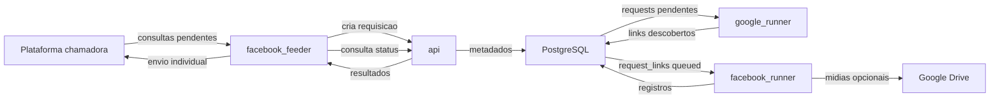

# GUIAI - Facebook Collector

Coletor de publicacoes do Facebook integrado ao fluxo de consultas da plataforma. O projeto recebe consultas externas por meio de um feeder, cria uma requisicao local, descobre links publicos do Facebook por busca no Google, enriquece cada link em processadores especializados, persiste os dados em PostgreSQL e devolve os resultados individualmente para a plataforma chamadora.

## Visao geral da arquitetura

A arquitetura atual foi consolidada para reduzir o numero de containers ativos e remover a dependencia de RabbitMQ. A stack principal possui cinco servicos: API, banco PostgreSQL, runner de descoberta via Google, runner de extracao do Facebook e feeder de integracao.



O feeder consulta periodicamente as requisicoes pendentes da plataforma chamadora, filtra as consultas da origem configurada para Facebook e cria a requisicao local na API. A API valida o contrato, garante unicidade por `id_query`, persiste os metadados em `requests` e deixa a requisicao marcada como pendente para processamento direto pelo banco. A partir dai, o processamento passa a ser assincrono por polling transacional.

O `google_runner` reivindica requisicoes pendentes em `requests`, monta consultas no formato `site:facebook.com "termo"` com suporte a `after:` e `before:` quando `start_date` e `end_date` forem informados, navega no Google com Selenium e `undetected_chromedriver`, trata paginas de captcha quando o 2Captcha estiver configurado, classifica cada URL encontrada por tipo de conteudo e grava as entradas em `request_links`. O `facebook_runner` reivindica `request_links` com status `queued`, controla concorrencia por advisory lock no PostgreSQL, abre as paginas do Facebook, extrai metadados e atualiza os registros de dominio. Enquanto a requisicao ainda esta em processamento, o feeder consulta a API em intervalos curtos e envia resultados novos individualmente para a plataforma chamadora, evitando esperar o termino total da consulta para exibir as primeiras publicacoes.

## Componentes

| Componente | Responsabilidade | Tecnologia principal |
| --- | --- | --- |
| `api` | API HTTP local, validacao de payload, criacao e consulta de requisicoes, execucao de migracoes, healthcheck e metricas. | FastAPI, Uvicorn, psycopg, Pydantic |
| `db` | Persistencia transacional de requisicoes, links descobertos, registros extraidos e controle de concorrencia do extrator. | PostgreSQL 16 |
| `google_runner` | Descoberta de URLs publicas do Facebook a partir de busca no Google, classificacao de URLs e gravacao em `request_links`. | Python, Selenium, undetected-chromedriver, BeautifulSoup, 2Captcha |
| `facebook_runner` | Extracao/enriquecimento de cada URL do Facebook, persistencia dos registros de dominio e arquivamento opcional de midias. | Python, Selenium, undetected-chromedriver, BeautifulSoup |
| `facebook_feeder` | Integracao com a plataforma chamadora: busca consultas pendentes, cria requisicoes locais, acompanha status e envia resultados um a um. | Python, requests, biblioteca de integracao da plataforma |

## Fluxo de execucao ponta a ponta

1. O feeder executa `getUnprocessedQueries()` e considera apenas consultas cujo `query_source` corresponde ao Facebook.
2. Para cada consulta pendente, o feeder normaliza `search_string` ou `subject`, preserva `id_query`, `start_date` e `end_date`, e chama `POST /requests` na API local.
3. A API cria ou reaproveita o usuario por `ip_request`, grava a requisicao em `requests` e marca `status_current = 1`.
4. O `google_runner` reivindica a requisicao no banco, marca `status_current = 2`, executa a busca no Google e grava cada URL em `request_links` com status `queued`.
5. Cada URL e classificada como `perfil`, `video`, `reel`, `post`, `storie`, `foto` ou `permalink`.
6. O `facebook_runner` reivindica os links `queued`, adquire um slot de concorrencia no PostgreSQL, navega no Facebook, extrai os campos possiveis e faz `upsert` na tabela de dominio correspondente.
7. Ao final de cada link, o runner atualiza `request_links` e recalcula o status geral da requisicao: pendente, processando, concluida, concluida com ausencias ou falha.
8. Enquanto o pipeline roda, o feeder consulta `GET /requests/query/{id_query}` e envia para a plataforma chamadora apenas registros ainda nao enviados, usando `sendQuerySingleResult()`.
9. Se a requisicao falhar e ainda houver tentativas disponiveis, o feeder chama `POST /requests/query/{id_query}/retry`; a API reenfileira a requisicao ate o limite configurado.

## Containers e desacoplamento

O compose ativo substitui o desenho legado de varios containers `facebook_runner_*` por um unico servico `facebook_runner` multi-tipo. Esse desenho reduz consumo de CPU/memoria, simplifica operacao e ainda permite escala horizontal quando necessario.

| Servico Docker | Nome do container | Porta externa padrao | Observacoes |
| --- | --- | --- | --- |
| `api` | `facebook_api_${SUFFIX}` | `${API_PORT_EXTERNAL}:8080` | Disponibiliza `/health`, `/metrics`, `/docs` e endpoints de requisicao. |
| `db` | `facebook_postgres_${SUFFIX}` | `${DB_PUBLISHED_PORT}:5432` | Volume `postgres_data`; tambem usado para advisory locks. |
| `google_runner` | `facebook_google_runner_${SUFFIX}` | `${GOOGLE_RUNNER_PORT_EXTERNAL}:8091` | Healthcheck proprio e perfil persistente do Chrome. |
| `facebook_runner` | Gerado pelo Compose | Exposto apenas na rede Docker | Pode ser escalado; nao possui `container_name` para permitir replicas. |
| `facebook_feeder` | `facebook_feeder_${SUFFIX}` | Sem porta externa | Executa loop de integracao com a plataforma chamadora. |

Para escalar a extracao sem recriar o desenho antigo, use o servico unico:

```bash
./scripts/hom.sh up -d --scale facebook_runner=2 facebook_runner
```

Antes de escalar, ajuste `FACEBOOK_EXTRACTOR_CONCURRENCY_LIMIT` para o limite real que a VM suporta. O limite interno usa `pg_try_advisory_lock`, portanto varias replicas respeitam a mesma fila logica de slots.

## Ambientes, scripts e portas

Os scripts em `scripts/` encapsulam o uso de `SUFFIX`, arquivo de ambiente e `project name` do Docker Compose. Eles seguem o padrao dos demais extratores.

| Script | Ambiente | Compose project | Arquivo de ambiente |
| --- | --- | --- | --- |
| `./scripts/dev.sh` | Desenvolvimento | `guaia-facebook-collector-dev` | `deploy/.env.dev` |
| `./scripts/hom.sh` | Homologacao | `guaia-facebook-collector-hom` | `deploy/.env.hom` |
| `./scripts/train.sh` | Treinamento | `guaia-facebook-collector-train` | `deploy/.env.train` |
| `./scripts/prod.sh` | Producao | `guaia-facebook-collector-prod` | `deploy/.env.prod` |

Mapeamento atual de portas externas:

| Ambiente | `SUFFIX` | Banco externo | API externa | Google runner |
| --- | --- | ---: | ---: | ---: |
| Desenvolvimento | `dev` | `5485` | `8094` | `8095` |
| Homologacao | `hom` | `5486` | `8089` | `8092` |
| Treinamento | `train` | `5487` | `8090` | `8093` |
| Producao | `prod` | `5488` | `8096` | `8097` |

As portas de banco e HTTP seguem o mapeamento oficial da planilha de portas e evitam colisao com os demais extratores na mesma VM.

## Contrato HTTP local

| Metodo e rota | Uso |
| --- | --- |
| `GET /health` | Verifica API e banco. Retorna `200` quando as dependencias ativas estao saudaveis. |
| `GET /metrics` | Expoe metricas Prometheus da API. |
| `POST /requests` | Cria uma requisicao local pendente para processamento direto pelo banco. Aceita um objeto unico ou uma lista com um unico objeto. |
| `GET /requests/query/{id_query}` | Recupera metadados e dados agregados de uma consulta externa. |
| `POST /requests/query/{id_query}/retry` | Reenfileira uma requisicao com falha, respeitando o limite de tentativas. |
| `GET /requests/{request_id}` | Recupera uma requisicao pelo identificador interno UUID. |

Payload minimo para criacao:

```json
{
  "id_query": 1000,
  "subject": "bolsonaro",
  "start_date": "2026-01-01T00:00:00Z",
  "end_date": "2026-06-01T23:59:59Z",
  "status_current": 1,
  "query_source": 5
}
```

`status_current` deve ser `1` na criacao. A API valida que `id_query` e numerico, que `subject` nao esta vazio e que `end_date` nao e anterior a `start_date`.

## Status da requisicao

| Codigo | Nome operacional | Significado |
| ---: | --- | --- |
| `1` | Pendente | Requisicao recebida e aguardando processamento. |
| `2` | Processando | Busca ou extracao em andamento. |
| `3` | Concluida | Todos os links processados com sucesso ou busca sem resultados. |
| `4` | Concluida com ausencias | Ha resultados processados, mas parte dos links falhou. |
| `5` | Falha | A requisicao falhou sem resultados aproveitaveis ou excedeu tentativas. |
| `6` | Cancelada | Reservado para cancelamento externo. |

## Processamento direto

O Facebook nao usa RabbitMQ no fluxo ativo. A API grava `requests`, o `google_runner` reivindica requisicoes pendentes com lock transacional e o `facebook_runner` reivindica `request_links` com status `queued`.

| Tabela/estado | Consumidor | Conteudo |
| --- | --- | --- |
| `requests.status_current = 1` | `google_runner` | Requisicoes completas com `request_id`, `id_query`, termo, datas e metadados. |
| `request_links.status = queued` | `facebook_runner` | Links classificados como `perfil`, `video`, `reel`, `post`, `storie`, `foto` ou `permalink`. |

As tentativas ficam em `requests.payload.worker_attempts` e `request_links.attempt_count`. Erros recuperaveis retornam o item para o estado pendente ate `MESSAGE_RETRY_MAX_ATTEMPTS`; erros terminais marcam o item como falho.

## Persistencia e modelo de dados

As migracoes ficam em `db/migrations` e sao executadas durante o bootstrap da API. O banco combina tabelas de controle de requisicao com tabelas de dominio por tipo de conteudo.

### `usuarios`

| Campo | Tipo | Descricao |
| --- | --- | --- |
| `id` | `UUID` | Identificador interno do solicitante, gerado por `gen_random_uuid()`. |
| `ip_request` | `VARCHAR(64)` | IP usado pela API local para agrupar requisicoes. |
| `numero_requests` | `INT` | Contador de requisicoes associadas ao IP. |
| `created_at` | `TIMESTAMP` | Data de criacao do registro. |
| `updated_at` | `TIMESTAMP` | Data da ultima atualizacao. |

### `requests`

| Campo | Tipo | Descricao |
| --- | --- | --- |
| `id` | `UUID` | Identificador interno da requisicao. |
| `user_id` | `UUID` | Referencia para `usuarios.id`. |
| `termo` | `TEXT` | Termo legado da busca. |
| `subject` | `TEXT` | Termo normalizado usado pelo pipeline atual. |
| `id_query` | `BIGINT` | Identificador da consulta externa; possui indice unico. |
| `start_date` | `TIMESTAMPTZ` | Data inicial opcional para a busca. |
| `end_date` | `TIMESTAMPTZ` | Data final opcional para a busca. |
| `filters` | `JSONB` | Filtros legados preservados para compatibilidade. |
| `payload` | `JSONB` | Metadados internos, como origem, `trace_id` e tentativas. |
| `status` | `VARCHAR(50)` | Status textual legado. |
| `status_current` | `SMALLINT` | Status numerico usado pela integracao. |
| `query_source` | `SMALLINT` | Codigo da origem da consulta. |
| `source_type` | `SMALLINT` | Codigo do tipo de fonte social. |
| `error` | `TEXT` | Erro consolidado da requisicao, quando houver. |
| `created_at` | `TIMESTAMP` | Data de criacao. |
| `updated_at` | `TIMESTAMP` | Data da ultima atualizacao. |

### `request_links`

| Campo | Tipo | Descricao |
| --- | --- | --- |
| `id` | `UUID` | Identificador interno do link descoberto. |
| `request_id` | `UUID` | Referencia para `requests.id`. |
| `tipo` | `VARCHAR(32)` | Tipo normalizado: `perfil`, `video`, `reel`, `post`, `storie`, `foto` ou `permalink`. |
| `fonte` | `TEXT` | URL do Facebook descoberta na busca. |
| `perfil_slug` | `TEXT` | Identificador textual do perfil quando extraido da URL. |
| `status` | `VARCHAR(32)` | Estado do link: `queued`, `processing`, `finished` ou `failed`. |
| `error` | `TEXT` | Erro especifico do link. |
| `created_at` | `TIMESTAMP` | Data de criacao. |
| `updated_at` | `TIMESTAMP` | Data da ultima atualizacao. |

### `perfil`

| Campo | Tipo | Descricao |
| --- | --- | --- |
| `id` | `UUID` | Identificador interno. |
| `fonte` | `TEXT` | URL unica do perfil. |
| `status` | `VARCHAR(32)` | Status da extracao do perfil. |
| `error` | `TEXT` | Mensagem de erro, quando houver. |
| `data` | `TIMESTAMP` | Data extraida quando disponivel. |
| `perfil` | `TEXT` | Nome ou identificador do perfil. |
| `verificado` | `BOOLEAN` | Indicador de perfil verificado, quando detectado. |
| `ultima_att` | `TIMESTAMP` | Data da ultima atualizacao do registro. |

### `video`, `reel`, `post`, `storie`, `foto` e `permalink`

Essas tabelas compartilham o mesmo conjunto de colunas, variando apenas o tipo de conteudo representado.

| Campo | Tipo | Descricao |
| --- | --- | --- |
| `id` | `UUID` | Identificador interno. |
| `fonte` | `TEXT` | URL unica do conteudo. |
| `status` | `VARCHAR(32)` | Status da extracao do conteudo. |
| `error` | `TEXT` | Mensagem de erro, quando houver. |
| `data` | `TIMESTAMP` | Data da publicacao quando identificada. |
| `perfil` | `TEXT` | Nome ou identificador do autor/perfil. |
| `verificado` | `BOOLEAN` | Indicador de autor verificado, quando detectado. |
| `descricao` | `TEXT` | Texto, legenda ou descricao extraida. |
| `num_comentarios` | `INT` | Quantidade de comentarios, quando disponivel. |
| `num_visualizacoes` | `INT` | Quantidade de visualizacoes, quando disponivel. |
| `num_reacoes` | `INT` | Quantidade de reacoes, quando disponivel. |
| `media_url` | `TEXT` | URL direta de imagem ou video encontrada na pagina. |
| `media_type` | `TEXT` | Tipo inferido da midia, como `imagem` ou `video`. |
| `drive_file_id` | `TEXT` | Identificador do arquivo salvo no Google Drive, quando habilitado. |
| `drive_url` | `TEXT` | URL de acesso ao arquivo salvo no Google Drive, quando habilitado. |
| `ultima_att` | `TIMESTAMP` | Data da ultima atualizacao do registro. |

## Envio de resultados para a plataforma chamadora

O feeder monta um DTO por registro antes de chamar `sendQuerySingleResult()`. O DTO contem os campos principais exigidos pela plataforma chamadora e um bloco `social_metadata` com os metadados especificos do Facebook.

Campos principais enviados:

| Campo | Origem |
| --- | --- |
| `id_query` | Metadados da requisicao externa. |
| `publication_date` | `data`, `created_at`, `updated_at` ou data atual como ultimo recurso. |
| `publication_text` | `descricao`, `description`, `texto` ou URL do registro. |
| `source_type` | Codigo configurado para fonte social. |
| `primary_source_name` | Perfil extraido, dominio da URL ou termo da busca. |
| `publication_url` | Campo `fonte` do registro. |
| `id_target_type` | Valor configurado em `FACEBOOK_FEEDER_TARGET_TYPES`. |
| `social_metadata` | DTO completo com tipo, status, contadores, midia e dados de Drive. |

O envio e incremental. O feeder mantem em memoria as chaves ja enviadas durante o acompanhamento de uma requisicao e, a cada consulta de status, envia somente registros novos. Isso permite que o front-end apresente resultados conforme eles surgem no banco.

## Descoberta, extracao e limitacoes

O coletor nao depende de API oficial do Facebook. A descoberta parte de buscas publicas no Google e a extracao usa paginas renderizadas por navegador automatizado. Essa estrategia e operacionalmente flexivel, mas esta sujeita a limites externos: captcha do Google, mudancas no HTML do Facebook, exigencia de login em algumas paginas, bloqueios temporarios, variacao de idioma/layout e indisponibilidade de dados publicos.

A busca respeita `FACEBOOK_RESULT_LIMIT`, atualmente configurado com valor padrao `200`, e `GOOGLE_RUNNER_MAX_PAGES`, que limita a quantidade de paginas do Google visitadas por requisicao. Quando a frase exata retorna poucos ou nenhum resultado, o `google_runner` pode tentar uma busca mais ampla sem aspas. `start_date` e `end_date` entram na consulta do Google como `after:` e `before:`, portanto funcionam como filtro de descoberta e dependem do indice do buscador.

O captcha do Google pode ser resolvido por 2Captcha quando `GOOGLE_2CAPTCHA_API_KEY` estiver configurada. Caso a resolucao falhe ou estoure o tempo limite, a mensagem e reenfileirada ate o limite de tentativas; ao exceder o limite, a requisicao recebe falha terminal. Bloqueios do proprio Facebook, paginas que exigem login e conteudos removidos sao tratados como falhas de link ou registros incompletos, sem derrubar necessariamente toda a requisicao.

## Arquivamento de midias

O `facebook_runner` baixa midias diretas quando `FACEBOOK_DOWNLOAD_MEDIA=true`. O destino e definido por `FACEBOOK_MEDIA_STORAGE`: em `auto`, `APP_ENV=production` salva no Google Drive usando as credenciais configuradas, enquanto ambientes de desenvolvimento, teste ou locais salvam em `FACEBOOK_MEDIA_LOCAL_PATH`. Tambem e possivel forcar `FACEBOOK_MEDIA_STORAGE=local` ou `FACEBOOK_MEDIA_STORAGE=google_drive`. A URL da midia pode vir dos JSONs embutidos do Facebook ou, quando habilitado, de metas `og:*` e tags `video`/`img` no DOM renderizado.

Variaveis relevantes:

| Variavel | Funcao |
| --- | --- |
| `FACEBOOK_DOWNLOAD_MEDIA` | Habilita ou desabilita download e arquivamento de midias. |
| `FACEBOOK_MEDIA_STORAGE` | Define o destino das midias: `auto`, `local` ou `google_drive`. |
| `FACEBOOK_MEDIA_COLLECT_FROM_DOM` | Habilita fallback de coleta de midia no DOM renderizado. |
| `FACEBOOK_MEDIA_PREFER_VIDEO` | Prioriza URLs de video quando houver mais de uma midia candidata. |
| `FACEBOOK_MEDIA_LOCAL_PATH` | Pasta base para arquivamento local em dev/test ou quando `FACEBOOK_MEDIA_STORAGE=local`. |
| `FACEBOOK_MEDIA_DOWNLOAD_TIMEOUT_SECONDS` | Tempo maximo de download por midia. |
| `FACEBOOK_MEDIA_MAX_BYTES` | Tamanho maximo aceito para uma midia. |
| `GOOGLE_DRIVE_SERVICE_ACCOUNT_JSON` | Credencial da conta de servico em JSON. |
| `GOOGLE_DRIVE_FOLDER_ID` | Pasta de destino no Google Drive. |

## Variaveis operacionais principais

| Variavel | Descricao |
| --- | --- |
| `APP_ENV` | Ambiente logico da aplicacao. |
| `SUFFIX` | Sufixo usado nos nomes de container, rede e projeto compose. |
| `REGISTRY_IMAGE` | Caminho base das imagens no registro GitLab. |
| `IMAGE_TAG` | Tag da imagem usada pelo ambiente. |
| `API_PORT_EXTERNAL` | Porta HTTP externa da API. |
| `DB_PUBLISHED_PORT` | Porta externa do PostgreSQL. |
| `GOOGLE_RUNNER_PORT_EXTERNAL` | Porta externa do healthcheck do `google_runner`. |
| `FACEBOOK_RESULT_LIMIT` | Limite de URLs descobertas por requisicao. |
| `GOOGLE_RUNNER_MAX_PAGES` | Numero maximo de paginas do Google por variante de busca. |
| `GOOGLE_CAPTCHA_TIMEOUT_SECONDS` | Tempo maximo aguardando solucao do captcha. |
| `FACEBOOK_RUNNER_PREFETCH_COUNT` | Numero de links reivindicados por ciclo do runner. |
| `FACEBOOK_EXTRACTOR_CONCURRENCY_LIMIT` | Limite global de extracoes simultaneas. |
| `FACEBOOK_EXTRACTOR_SLOT_WAIT_SECONDS` | Tempo maximo aguardando um slot de extracao. |
| `MESSAGE_RETRY_MAX_ATTEMPTS` | Numero maximo de retentativas por mensagem. |
| `DIRECT_RUNNER_POLL_SECONDS` | Intervalo de polling dos runners diretos no banco. |
| `FACEBOOK_FEEDER_POLL_INTERVAL` | Intervalo para buscar novas consultas externas. |
| `FACEBOOK_FEEDER_WAIT_POLL_SECONDS` | Intervalo para consultar status local e enviar resultados incrementais. |
| `FACEBOOK_FEEDER_REQUEST_RETRY_LIMIT` | Limite de reenvio de requisicoes locais com falha. |

## Operacao local na VM

Subir homologacao:

```bash
cd /home/guaia-etc/facebook_collector/guaia-facebook-collector-hom
./scripts/hom.sh up -d
```

Verificar servicos:

```bash
./scripts/hom.sh ps
curl -fsS http://127.0.0.1:8089/health
curl -fsS -o /dev/null -w 'docs_status=%{http_code}\n' http://127.0.0.1:8089/docs
```

Consultar itens pendentes no banco:

```bash
./scripts/hom.sh exec db psql -U "$DB_USER" -d "$DB_NAME" -c "select status_current, count(*) from requests group by status_current;"
./scripts/hom.sh exec db psql -U "$DB_USER" -d "$DB_NAME" -c "select status, count(*) from request_links group by status;"
```

Consultar uma requisicao por `id_query`:

```bash
curl -fsS http://127.0.0.1:8089/requests/query/1000
```

Executar testes das imagens:

```bash
docker run --rm registry.gitlab.com/fakenews-tre-go/guaia-facebook-collector/api:hom pytest
docker run --rm registry.gitlab.com/fakenews-tre-go/guaia-facebook-collector/google-runner:hom pytest
docker run --rm registry.gitlab.com/fakenews-tre-go/guaia-facebook-collector/facebook-runner:hom pytest
docker run --rm registry.gitlab.com/fakenews-tre-go/guaia-facebook-collector/feeder:hom pytest
```

## Observabilidade e saude

Todos os servicos de processamento registram eventos estruturados com `request_id`, `id_query`, `user_id`, `trace_id`, tentativa e status operacional. A API expoe `/metrics` para Prometheus e `/health` para verificacao de API e banco. Os runners possuem healthcheck HTTP proprio e dependem do healthcheck de banco antes de iniciar.

Durante incidentes, a ordem recomendada de diagnostico e:

1. Verificar `./scripts/<ambiente>.sh ps`.
2. Consultar `/health` da API e do `google_runner`.
3. Consultar `requests`, `request_links` e a tabela de dominio relacionada ao tipo do link.
4. Conferir `attempt_count` em `request_links` e `worker_attempts` em `requests.payload`.
5. Conferir logs do `google_runner`, `facebook_runner` e `facebook_feeder`.

## Estrutura do repositorio

| Caminho | Conteudo |
| --- | --- |
| `api/` | Aplicacao FastAPI, rotas, schemas, servicos de requisicao, migracoes e testes. |
| `google_runner/` | Descoberta de links via Google, resolucao de captcha, polling direto em `requests` e testes. |
| `facebook_runner/` | Extracao de paginas do Facebook, persistencia de registros, controle de concorrencia, arquivamento de midias e testes. |
| `feeder/` | Integracao com a plataforma chamadora e envio incremental de resultados. |
| `shared/python/app_shared/` | Configuracao, status, observabilidade e utilitarios compartilhados. |
| `db/migrations/` | Migracoes SQL versionadas do PostgreSQL. |
| `deploy/` | `docker-compose.yml` e exemplos/arquivos de ambiente. |
| `scripts/` | Atalhos por ambiente para executar Docker Compose com `SUFFIX` e arquivo `.env` corretos. |

## Notas de manutencao

- Nao grave credenciais reais em `.env.example`, README ou arquivos versionados.
- Ao criar novas tabelas ou colunas, inclua migracao SQL em `db/migrations` e teste o bootstrap da API.
- Ao alterar o polling direto, atualize os runners, o compose e esta documentacao.
- Ao aumentar paralelismo, valide CPU, memoria, banco e captchas em teste de carga antes de aplicar em homologacao ou producao.
- Mantenha o runner multi-tipo como padrao; crie containers separados apenas se houver um motivo operacional medido.
